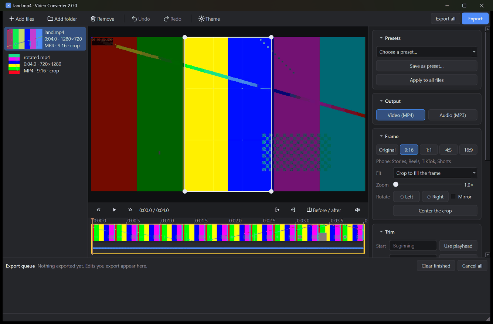

# Free Video Editor

[](https://github.com/Ahmed41022/free-video-editor/actions/workflows/tests.yml)

A Windows video editor that reshapes, crops, cuts and joins videos into new MP4s, for example to fit a phone
screen for Stories, Reels, TikTok or Shorts, changes their speed, adds fades, adjusts and steadies the picture,
and turns videos into MP3 audio.
Everything runs locally on your computer; no files are uploaded anywhere.



## Download

Get either file from the [latest release](https://github.com/Ahmed41022/free-video-editor/releases/latest):

- **`FreeVideoEditor-Setup-<version>.exe`**: the installer. It installs just for you (no administrator
  rights needed, or choose all users), adds a Start menu entry, optionally a desktop shortcut, and an
  "Open with Free Video Editor" entry for video and audio files. It doesn't change which app opens your files by
  default. Remove it from Windows **Settings → Apps**.
- **`FreeVideoEditor.exe`**: the portable version. Double-click it; nothing to install.

Everything the app needs is built in either way.

> Windows SmartScreen may warn about an unrecognized app the first time because the files aren't code-signed.
> Click **More info → Run anyway**.

## Features

**Editor**
- Video player with a timeline: thumbnails, audio waveform, and drag handles to trim
- Cut sections out of the middle: split at the playhead, remove the parts you don't want, and drag the edges
  of a cut on the timeline to adjust it (right-click the timeline for more). Playback skips the cut parts
- Join several files into one video, in list order: drag files in the list to reorder them
- Crop box right on the video: drag it to choose what to keep, drag a corner (or scroll) to zoom
- Before / after view that renders exactly what the export will look like, adjustments and looks included
- Undo and redo for every change, dark and light themes, and drag-and-drop of files and folders
- Each file keeps its own settings; **Apply to all files** copies them to the rest (each keeps its own crop,
  trim and cuts)
- Export queue that runs in the background with progress, time left, cancel and "show in folder"

**Video (MP4)**
- Reshape for phones (9:16), square posts (1:1), portrait posts (4:5) or widescreen (16:9)
- Crop to fill the frame, or fit the whole video with a blurred background or black bars
- Rotate, mirror, remove the sound, and pick the size (up to 1080p, 1080p, 720p, 480p), frame rate and quality
- Adjust brightness, contrast, saturation and gamma, sharpen, and reduce noise
- One-click color looks: black and white, warm, cool, vintage and high contrast, on top of the adjustments
- Stabilize shaky phone footage (light or strong). It runs when exporting, in two passes, so it takes longer
  and the preview doesn't show it
- Make videos play on your phone: a steady 60 or 30 fps frame rate (game recordings and screen captures often
  vary, which some phones refuse to play) with phone-safe H.264 and AAC, in one click with the
  **Play on phone** preset
- One-click presets for Play on phone, TikTok / Reels / Shorts, Instagram, YouTube and WhatsApp status, plus
  your own saved presets
- Phone recordings that are stored sideways are detected and shown the right way up

**Audio (MP3)**
- 128 / 192 / 256 / 320 kbps or variable bitrate, keeping title and artist metadata

**Both**
- Trim to any range, e.g. from `0:15` to `1:02:30`, and cut out as many sections as you like
- Speed from 0.25× to 4× with natural-sounding audio (the pitch stays the same), and play backwards
- Fade in and out, with separate lengths for the picture and the sound
- Never overwrites anything: edits are saved as `name (phone).mp4`, `name (square).mp4`, …,
  and existing names get a number (`file.mp3` becomes `file (1).mp3`)
- Accepts MP4, MOV, MKV, AVI, WEBM, M4V and other common video formats, and audio files (MP3, M4A, AAC, WAV,
  FLAC, OGG, OPUS) to trim, cut or save as MP3

## How to use

1. Click **Add files** or **Add folder**, or drop videos onto the window (or onto the exe)
2. Pick a file, then choose a preset or set the shape, crop, picture, trim, cuts, speed and fades on the right
3. Click **Export** (or **Export all**); exports run in the queue at the bottom while you keep working

To make one video from several files, put them in the order you want (drag them in the list), select the
ones to join (or none, to join them all) and click **Join into one**. Each clip keeps its own crop, cuts,
speed and fades; the result takes its size, frame rate and quality from the first clip, and clips of
another shape get black bars. If the first clip is set to MP3, you get one MP3 instead.

### Videos that won't play on your phone

Game recordings and screen captures often have a frame rate that changes from moment to moment (and says it
could be 120 fps), and some phones just say the video is unsupported. To fix one:

1. Add the video and pick it in the list. If its frame rate is the problem, a note under **Frame rate** in
   **Video quality** says so.
2. Choose the **Play on phone (keeps the whole picture)** preset. It keeps the video's shape and sound, makes it
   no bigger than 1080p, and gives it a steady 60 fps. To use 30 fps instead, change **Frame rate** to
   **Steady 30 fps**.
3. Click **Export**. The result is saved next to the original as `name (phone-ready).mp4`.

To convert a whole folder, add the folder, choose the preset for one file, click **Apply to all files**, then
**Export all**. A video that is slower than the rate you choose keeps its own rate (a 30 fps video stays at 30 fps
with Steady 60), and the original is never changed.

### Keyboard shortcuts

| Key | Action |
| --- | --- |
| Space | Play / pause |
| J / L | Back / forward 5 seconds |
| ← / → | Previous / next frame (hold Shift for 1 second) |
| I / O | Start / end the trim at the playhead |
| S | Split at the playhead |
| X | Cut out the part under the playhead |
| B | Before / after view |
| Ctrl+Z / Ctrl+Y | Undo / redo |
| Ctrl+O | Add files |
| Ctrl+E / Ctrl+Shift+E | Export the selected file / export all |
| Ctrl+J | Join the files into one |

## Running from source

Requires Python 3.9+, the packages in `requirements.txt` (`pip install -r requirements.txt`), and ffmpeg
(`winget install Gyan.FFmpeg`, `brew install ffmpeg`, `sudo apt install ffmpeg`, or `pip install imageio-ffmpeg`). The app looks for ffmpeg in the `FFMPEG_PATH` environment variable, then on your `PATH`,
then in `imageio-ffmpeg`.

```bash
python -m video_converter
```

On Windows you can also double-click **`Free Video Editor.pyw`**.

### Command line

Pass one or more files to convert them without opening the window:

```bash
python -m video_converter "My video.mp4" another.mp4 -q 320 -o converted
python -m video_converter "My video.mp4" --video phone --fit blur --start 0:10 --end 0:40
python -m video_converter "My video.mp4" --video original --cut 0:05-0:12 --cut 1:00-1:10 --speed 1.5
python -m video_converter intro.mp4 main.mp4 --video widescreen --fade-in 1 --fade-out 2 --join
python -m video_converter "Game clip.mp4" --video original --fps 60 --size up1080   # plays on a phone
```

| Option | Description |
| --- | --- |
| `-q`, `--quality` | MP3 quality: `128`, `192` (default), `256`, `320`, `vbr`, or `vbr-high` |
| `-o`, `--output-dir` | Folder for the results (default: next to each video) |
| `--start`, `--end` | Trim, e.g. `--start 0:15 --end 1:02:30` |
| `--overwrite` | Replace existing files instead of adding ` (1)` to the name |
| `--video` | Export an MP4 instead: `phone`, `square`, `portrait`, `widescreen`, or `original` |
| `--fit` | `crop` (default), `blur`, or `bars` |
| `--position X Y` | Crop position from 0 to 1 (default `0.5 0.5`, the center; other values are refused) |
| `--zoom` | Crop tighter, `1.0` to `3.0` (other values are refused) |
| `--rotate` | `90`, `180`, or `270` degrees clockwise |
| `--mirror`, `--mute` | Flip left-right; remove the sound |
| `--size` | Short side in pixels: `1080`, `720`, or `480`, or `up1080` for the source's size but at most 1080 (never enlarged). Default: the source's short side; phone, portrait and square stop at `1080` |
| `--fps` | `60` or `30` for a steady frame rate with phone-safe H.264 and AAC (a slower video keeps its own rate), or `source` (default) to leave it alone. `--video original --fps 60` makes a copy that plays on a phone, saved as `name (phone-ready).mp4` |
| `--video-quality` | `high`, `balanced` (default), or `small` |
| `--cut START-END` | Remove a section, e.g. `--cut 0:05-0:12`; repeat it to remove more |
| `--speed` | `0.25` to `4`, e.g. `2` for twice as fast (default `1`) |
| `--reverse` | Play backwards (holds every frame in memory, so a long clip prints a warning) |
| `--fade-in`, `--fade-out` | Fade the picture and sound in from / out to black and silence, in seconds |
| `--join` | Make one file of all the inputs, in the order given (an MP4 with `--video`, else an MP3) |
| `--brightness`, `--contrast`, `--saturation`, `--gamma` | Adjust the picture, e.g. `--contrast 1.2` (`--help` lists the ranges) |
| `--sharpen`, `--denoise` | Sharpen (`0` to `1.5`) or reduce noise (`0` to `10`) |
| `--look` | `bw`, `warm`, `cool`, `vintage`, or `contrast` |
| `--stabilize` | `light` or `strong` |

## Building the exe

```bash
python -m venv .venv
.venv\Scripts\pip install -r requirements-build.txt
.venv\Scripts\python build_exe.py
```

The result is `dist\Free Video Editor.exe`, a single file that includes ffmpeg and the Qt libraries.

To also build the installer, install [Inno Setup 6](https://jrsoftware.org/isdl.php) and add `--installer`:
`.venv\Scripts\python build_exe.py --installer` writes `dist\FreeVideoEditor-Setup-<version>.exe`
(`ISCC.exe` is found on `PATH`, in its usual install folder, or through the `ISCC` environment variable).
The installer script is `installer\FreeVideoEditor.iss`.

## Running the tests

```bash
python -m unittest discover -s tests -v
```

The tests generate short sample videos with ffmpeg and skip what they can't run: the conversion tests need
ffmpeg, and the editor tests (`tests/test_ui.py`) need PySide6, so run them from the build environment:
`.venv\Scripts\python -m unittest discover -s tests`.
GitHub runs the whole suite on every push and pull request (`.github/workflows/tests.yml`).

## Releases

Bump `__version__` in `video_converter/__init__.py`, then push a tag with the same number, e.g. `v2.3.2`.
The **Release** workflow (`.github/workflows/release.yml`) refuses a tag that doesn't match `__version__`, runs
the tests, builds the exe and the installer, and creates a **draft** release with both files and their
SHA-256 checksums. Nothing is published until you publish the draft. If a release for the tag already exists,
the files are uploaded to it instead. Running the workflow by hand from the Actions tab only builds the files
and attaches them to the run.

## License

Free Video Editor is released under the [MIT License](LICENSE).
The Windows exe bundles FFmpeg (GPLv3) and Qt for Python (LGPLv3); see [licenses/](licenses/).
